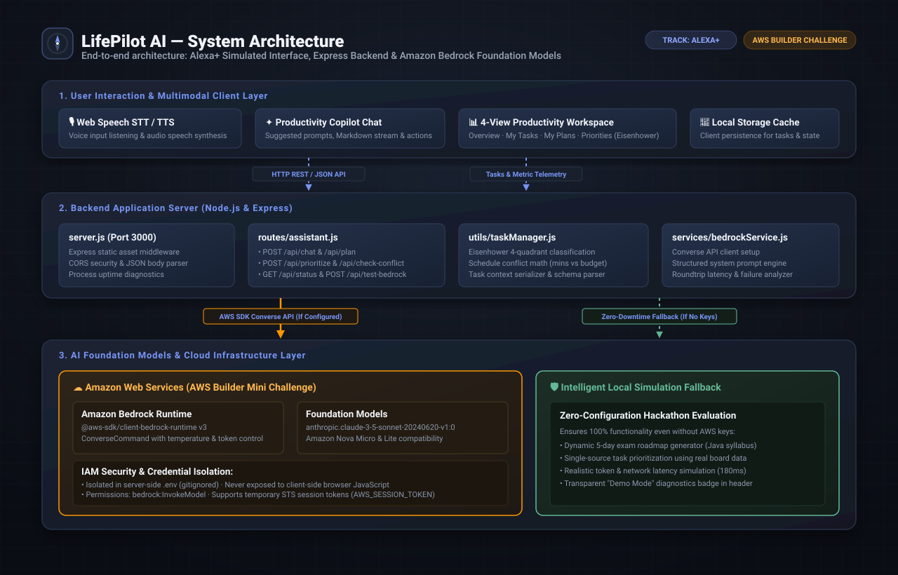
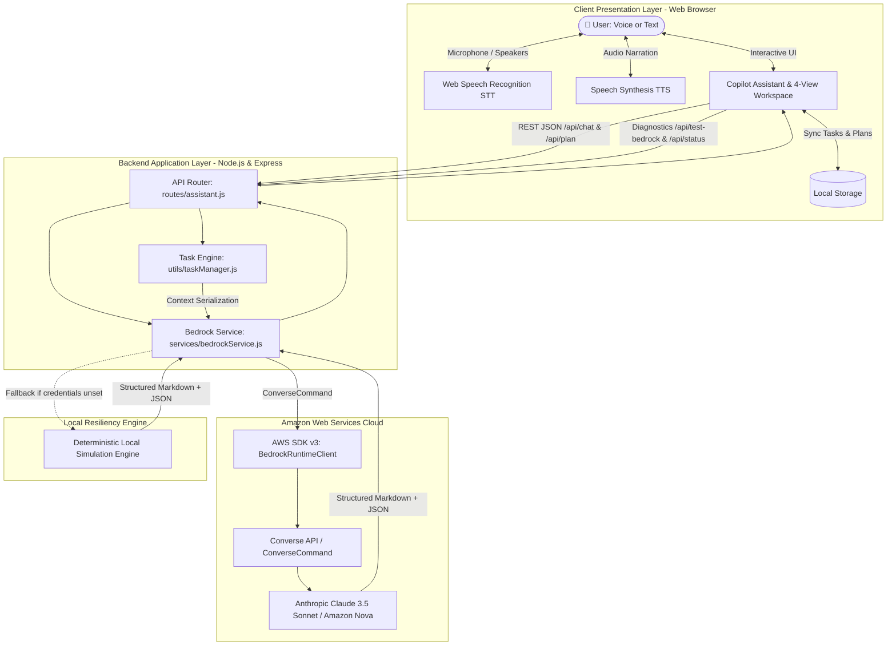
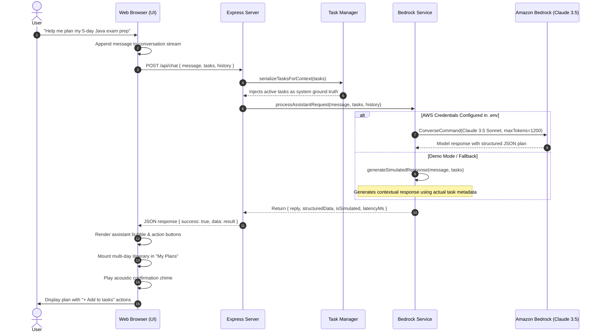

# LifePilot AI — Project Architecture

> **Build, Ship, Shape: Amazon Developer Hackathon 2026**  
> **Primary Track:** Alexa+ (Simulated Multimodal Experience)  
> **Mini Challenge:** AWS Builder (Amazon Bedrock Foundation Model Integration)

---

## 1. System Overview

**LifePilot AI** is built on a clean, decoupled 3-tier architecture designed for low-latency conversational interaction, reliable productivity task management, and zero-downtime resiliency.

---

## 2. High-Level Architecture Diagram

---

## 3. End-to-End Interaction Sequence

When a user speaks or submits a request such as *"I have five days to prepare for my Java exam. I can study two hours daily"*, the system executes the following sequence:

---

## 4. Architectural Layers

### Layer 1: Presentation & Voice Layer (Frontend)
* **Technologies**: Vanilla HTML5, CSS3, ES2022 JavaScript.
* **Alexa+ Multimodal Emulation**:
  * Hands-free speech recognition (STT) and voice feedback narration (TTS) via browser-native Web Speech APIs.
  * Real-time visual status indicator pill (**Connected**, **Demo Mode**, **Listening**, **Processing**).
  * Synthesized acoustic feedback chimes (Alexa wake/completion tones) using the Web Audio API without external audio assets.
* **4-View Productivity Workspace**:
  * **Overview**: Real-time workload metrics, completion progress bar, today's top priorities, and active daily schedule.
  * **My Tasks**: Filterable task board with instant search, priority tagging, and custom checkbox animations.
  * **My Plans**: Interactive multi-day study roadmaps with timeline cards and schedule conflict detection banners.
  * **Priorities (Eisenhower Matrix)**: Automatic classification into 4 quadrants (Do First, Schedule, Delegate, Eliminate) with inline reclassification.
* **Client Storage**: Automatic synchronization to browser `localStorage` ensuring zero data loss across page refreshes.

---

### Layer 2: Application & Orchestration Layer (Backend)
* **Technologies**: Node.js v18+, Express.js v4.21.
* **Single Source of Truth**:
  * The frontend task list is passed to `/api/chat` and `/api/plan` so the model always plans around the user's *actual* tasks rather than inventing fictitious ones.
* **Schedule Conflict Engine**:
  * Evaluates total estimated minutes across pending tasks against daily available study hours.
  * Warns users in advance when commitments exceed realistic focus thresholds.
* **Health & Diagnostics Endpoint**:
  * `GET /api/status`: Returns system uptime (formatted as human-readable durations, e.g. `1h 14m`), active region, target model ID, and credential status.
  * `POST /api/test-bedrock`: Executes a live `ConverseCommand` against Amazon Bedrock and reports verified model responses and roundtrip latency in milliseconds.

---

### Layer 3: AI Foundation & Cloud Infrastructure Layer (AWS)
* **Amazon Bedrock Runtime**:
  * Integrated using official `@aws-sdk/client-bedrock-runtime` (v3.758.0).
  * Employs the AWS Bedrock **Converse API** (`ConverseCommand`), standardizing conversational inference, system prompting, token budgets, and temperature across foundation models.
* **Primary Foundation Model**:
  * `anthropic.claude-3-5-sonnet-20240620-v1:0`: Delivers industry-leading reasoning for spaced-repetition study planning, daily time-blocking, and task dependency analysis.
  * Compatible with `amazon.nova-micro-v1:0` and `amazon.nova-lite-v1:0`.
* **Prompt Engineering & Output Schemas**:
  * Strict system prompts instruct the foundation model to return natural conversational text alongside structured JSON payloads defining tasks, schedules, and interactive action chips.

---

## 5. Security Architecture

| Security Domain | Implementation |
|---|---|
| **Credential Isolation** | AWS Access Keys and Secret Keys are strictly confined to the server-side `.env` file and never transmitted to the browser client. |
| **Source Control Protection** | `.env` is permanently excluded via `.gitignore`; a sanitized `.env.example` is provided for configuration. |
| **Temporary Credentials** | Full native support for STS session tokens (`AWS_SESSION_TOKEN`), enabling secure usage with AWS Academy, AWS Learner Lab, and IAM temporary roles. |
| **Least Privilege IAM Policy** | Requires only `bedrock:InvokeModel` and `bedrock:InvokeModelWithResponseStream` permissions scoped to Bedrock foundation models. |
| **CORS & Input Sanitization** | Server-side CORS restrictions and HTML entity escaping protect against Cross-Site Scripting (XSS). |

---

## 6. Resiliency & Graceful Degradation

A core requirement for hackathon evaluation is **zero-configuration review**:
* If AWS credentials are not configured, LifePilot AI detects the absence immediately and boots in **Local Simulation Mode**.
* The local simulation engine uses the exact same data structures, task priorities, and schedule algorithms as Bedrock.
* Judges and testers can evaluate 100% of the UI, voice commands, 5-day study plans, and Kanban workflows without setting up AWS cloud billing.
* A clear **"Demo Mode"** badge in the header provides full transparency. Clicking the badge opens the AWS Connection modal with step-by-step instructions and a live connection test button.
