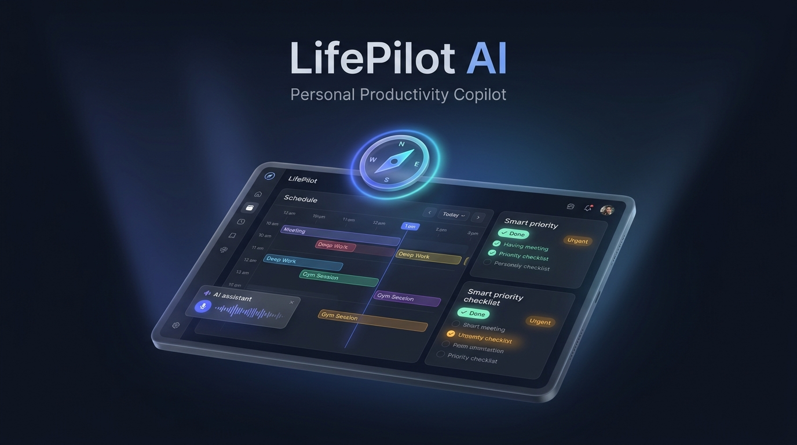
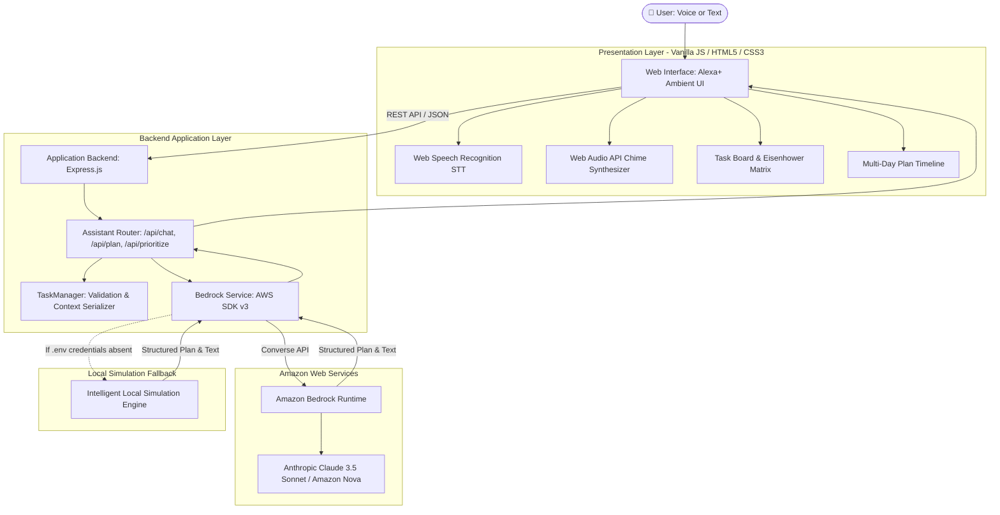

# LifePilot AI — Your Personal AI Assistant
### *Simulated Alexa+ Productivity Experience powered by Amazon Bedrock*

<p align="center">
  
</p>

<p align="center">
  <a href="https://aws.amazon.com/bedrock/"></a>
  <a href="https://devpost.com/"></a>
  <a href="#-alexa-hackathon-alignment"></a>
  <a href="AWS_INTEGRATION.md"></a>
  <a href="https://github.com/nikhil-codes-tech/lifepilot"></a>
  <a href="LICENSE"></a>
  <a href="#-testing--verification"></a>
</p>

---

## 📑 Core Documentation Deliverables

For judges, evaluators, and developers, this repository includes dedicated technical specifications:

| Document | Description | Format |
|---|---|---|
| **[System Architecture](ARCHITECTURE.md)** | End-to-end 3-layer system design, Mermaid interaction sequence diagrams, data flow, and resiliency patterns | [Markdown](ARCHITECTURE.md) · [Vector SVG](architecture.svg) |
| **[Setup & Installation Guide](SETUP.md)** | Prerequisites, 3-minute quickstart, AWS IAM configuration, Bedrock model access, and troubleshooting matrix | [Markdown](SETUP.md) |
| **[AWS Bedrock Integration Report](AWS_INTEGRATION.md)** | AWS Builder Mini Challenge report: Converse API, foundation models, task context serialization, and security | [Markdown](AWS_INTEGRATION.md) |

---

## 🌟 Executive Summary

**LifePilot AI** is an intelligent personal productivity assistant designed to help students, developers, and busy professionals streamline their daily schedules through natural conversational interactions.

Inspired by the next-generation **Alexa+** conversational assistant, LifePilot AI allows users to speak or type everyday goals—such as *"I have five days to prepare for my Java exam. Help me create a revision plan"* or *"Help me plan my day"*—and receive structured, time-blocked itineraries that transfer directly into an interactive task board.

Powered server-side by **Amazon Bedrock** (featuring Anthropic Claude 3.5 Sonnet and Amazon Nova via the AWS SDK v3 Converse API), LifePilot AI also provides a transparent, zero-configuration **Local Simulation Engine** so hackathon judges and testers can immediately test every voice, chat, plan, and Kanban flow without requiring immediate AWS cloud credentials.

---

## 🎯 Hackathon Tracks & Alignments

| Category | Details |
|---|---|
| **Event** | Build, Ship, Shape: Amazon Developer Hackathon 2026 |
| **Primary Track** | **Alexa+** (Simulated Experience Route) |
| **Mini Challenge** | **AWS Builder** (Amazon Bedrock Integration) |
| **Project Category** | Artificial Intelligence, Productivity & Personal Assistance |
| **Frontend** | HTML5, CSS3 (Restrained Dark Design System), Vanilla JavaScript |
| **Backend** | Node.js, Express.js |
| **AI Integration** | Amazon Bedrock (`@aws-sdk/client-bedrock-runtime`) |
| **Voice & Audio** | Web Speech API (STT & TTS) + Web Audio API Chime Synthesizer |
| **Repository** | [https://github.com/nikhil-codes-tech/lifepilot.git](https://github.com/nikhil-codes-tech/lifepilot.git) |

---

## 💡 Key Features

### 1. Simulated Alexa+ Conversational Assistant (Primary Track)
* **Voice Input (STT)**: Hands-free voice commands powered by the browser's Web Speech API.
* **Alexa Ambient Glow Ring**: Dynamic animated ring with 4 visual reactive states:
  * 🌀 **Idle**: Soft breathing ambient glow
  * 🎙️ **Listening**: Cyan pulsing acoustic wave
  * ⚡ **Thinking**: Rotating gradient halo while Bedrock computes plans
  * 🔊 **Speaking**: Violet harmonic pulse during narration
* **Acoustic Feedback**: Web Audio API synthesizer generates the signature Alexa wake chime and completion tones with zero external audio assets.
* **Voice Narration (TTS)**: Assistant responses can be read aloud in real-time with toggle control.
* **Quick Prompt Chips**: Instant access to high-yield scenarios (5-Day Java Exam Plan, Workday Planning, Task Prioritization, Task Addition, Schedule Summaries).

### 2. Multi-Day & Daily Plan Generator
* **Spaced-Repetition Study Roadmaps**: Day-by-day milestone breakdowns for exam prep (e.g., 5-day Java syllabus from fundamentals to timed mock tests).
* **Interactive Day Tabs**: Effortlessly switch between Day 1, Day 2, Day 3, etc.
* **1-Click Task Transfer**: Click **"➕ Add to Tasks"** on any scheduled item or **"➕ Add All to Tasks"** to instantly convert AI recommendations into actionable Kanban items.

### 3. Smart Task Board & Kanban
* **Single Source of Truth**: The active task board is injected into Bedrock's context prompt, ensuring AI recommendations reflect the user's actual tasks.
* **Task Prioritization**: Categorized by High (🔴), Medium (🟡), and Low (🟢) priority.
* **Category Tagging**: Study, Work, Coding, Health, Personal, and General.
* **Progress Tracking**: Real-time completion percentage, pending counters, and search filtering.
* **Offline Persistence**: Automatically synchronized to browser `localStorage`.

### 4. Eisenhower Decision Matrix
* Automatically sorts pending tasks into the four strategic quadrants:
  * **Q1 (Do First)**: Urgent & High Importance (Deadlines within 48h)
  * **Q2 (Schedule)**: High Importance, Long-Term (Exam study, projects)
  * **Q3 (Quick Wins)**: Urgent, Low Complexity (Check-ins, syncs)
  * **Q4 (Minimize)**: Low Urgency & Importance
* **AI Prioritize Button**: One click asks Amazon Bedrock to summarize your highest-impact action items for the morning.

---

## 🏗️ System Architecture

<p align="center">
  
</p>

For full architecture documentation and sequence diagrams, see **[ARCHITECTURE.md](ARCHITECTURE.md)**.



---

## 🛠️ Technology Stack

| Layer | Technology | Purpose |
|---|---|---|
| **Frontend** | HTML5, CSS3, JavaScript | Restrained dark dashboard, glowing Alexa ring animations |
| **Voice & Audio** | Web Speech API, Web Audio API | Speech-to-text, text-to-speech, synthetic Alexa chimes |
| **Backend** | Node.js (v18+), Express.js | Server-side execution, REST APIs, input sanitization |
| **AI Integration** | Amazon Bedrock (`@aws-sdk/client-bedrock-runtime`) | Foundation model inference (Converse API) |
| **Storage** | Browser `localStorage` | Client-side task & plan persistence |
| **Testing** | Node.js Native Test Assertions, E2E HTTP Suite | Automated unit, integration, and HTTP tests |

---

## 🚀 Quick Start Guide

For full step-by-step setup and IAM permissions guide, see **[SETUP.md](SETUP.md)**.

### Prerequisites
* [Node.js](https://nodejs.org/) v18.0.0 or higher
* npm (bundled with Node.js)
* Modern web browser (Chrome, Edge, Safari, Firefox)

### 1. Installation
Clone the repository and install dependencies:
```bash
git clone https://github.com/nikhil-codes-tech/lifepilot.git
cd lifepilot
npm install
```

### 2. Configure Environment (Optional for Live Bedrock)
Copy the example environment file:
```bash
cp .env.example .env
```
Open `.env` to configure your AWS credentials:
```env
PORT=3000
AWS_REGION=us-east-1
AWS_ACCESS_KEY_ID=your_access_key_here
AWS_SECRET_ACCESS_KEY=your_secret_key_here
BEDROCK_MODEL_ID=anthropic.claude-3-5-sonnet-20240620-v1:0
```

> **Note for Hackathon Judges**: If you do not have AWS credentials configured, LifePilot AI **automatically boots in Local Simulation Mode**. All prompts, 5-day study plans, task additions, and Eisenhower matrices work seamlessly right out of the box with zero configuration!

### 3. Verify Bedrock Connectivity
Run the built-in diagnostic test:
```bash
npm run verify-bedrock
```

### 4. Launch the Server
```bash
npm start
```
Open your browser and navigate to:
```
http://localhost:3000
```

---

## 🧪 Testing & Verification

LifePilot AI includes a comprehensive automated test suite verifying task validation, Eisenhower classification, markdown parsing, simulation generation, conflict detection, and live Express HTTP endpoints.

Run all tests:
```bash
npm test
```

Expected output:
```text
🧪 Starting LifePilot AI Automated Test Suite...

  ✅ PASS: Task validation assigns defaults and formats fields
  ✅ PASS: Task validation throws error when title is empty
  ✅ PASS: Prioritization properly classifies tasks into Eisenhower quadrants
  ✅ PASS: serializeTasksForContext returns formatted context string
  ✅ PASS: extractActionableItems extracts structured tasks and plans from markdown
  ✅ PASS: getPrioritizationReason generates explanation from actual metadata
  ✅ PASS: computeWorkloadMetrics accurately calculates counts and focus time
  ✅ PASS: checkScheduleConflict detects when task duration exceeds available time
  ✅ PASS: getInitialTasks returns standard shared tasks list
  ✅ PASS: Simulation engine creates complete 5-day Java study plan
  ✅ PASS: Simulation engine creates structured daily plan
  ✅ PASS: Simulation engine analyzes and prioritizes tasks

====================================================
Test Results: 12/12 passed (100%)
====================================================

🚀 Launching E2E Server Test on port 3456
Testing GET / (index.html)...
  ✅ Static index.html served successfully
Testing GET /api/status...
  ✅ /api/status online
Testing POST /api/chat with Java Exam prompt...
  ✅ /api/chat generated structured 5-day plan successfully!
     Plan Title: 5-Day Java Revision Plan
     Days count: 5
Testing POST /api/prioritize...
  ✅ /api/prioritize calculated Eisenhower matrix and recommendation!
Testing POST /api/check-conflict...
  ✅ /api/check-conflict detected conflict successfully: 1h 15m

🎉 ALL END-TO-END TESTS PASSED CLEANLY!
```

---

## 📚 Sample Scenarios & Prompts

| User Request | Expected LifePilot AI Action |
|---|---|
| *"I have five days to prepare for my Java exam. Help me create a revision plan."* | Generates a 5-day spaced repetition schedule (Fundamentals, OOP, Collections, Practice, Mock Test) with time blocks and an **"Add All to Tasks"** button. |
| *"Help me plan my day."* | Constructs an 8-hour workday timeline with deep-work focus blocks, sync slots, and wellbeing breaks based on actual active tasks. |
| *"What should I prioritize today?"* | Evaluates active tasks against the Eisenhower Matrix and provides a strategic morning focus directive. |
| *"Add a task to complete my project by tomorrow."* | Extracts title, sets High priority, tags Coding category, sets tomorrow's due date, and mounts to task board. |
| *"Summarize my pending tasks."* | Generates an executive summary of pending vs completed items. |

---

## 🌐 AWS Builder Mini Challenge Alignment

For complete technical depth, please see **[AWS_INTEGRATION.md](AWS_INTEGRATION.md)**.

* **Service Used**: **Amazon Bedrock** (Runtime API via `@aws-sdk/client-bedrock-runtime`).
* **Models Supported**:
  * `anthropic.claude-3-5-sonnet-20240620-v1:0` (Default)
  * `anthropic.claude-3-haiku-20240307-v1:0`
  * `amazon.nova-micro-v1:0` & `amazon.nova-lite-v1:0`
* **Implementation Location**:
  * [services/bedrockService.js](services/bedrockService.js): AWS SDK client initialization, `ConverseCommand` dispatch, system prompts, latency tracking, error handling, and local fallback.
  * [routes/assistant.js](routes/assistant.js): REST API endpoints (`/api/chat`, `/api/plan`, `/api/prioritize`, `/api/test-bedrock`).
  * [test/verifyBedrock.js](test/verifyBedrock.js): Standalone verification script for AWS credentials and model access.
* **AWS Setup Highlights**:
  1. Attach `bedrock:InvokeModel` and `bedrock:InvokeModelWithResponseStream` to your IAM user.
  2. Request access for Claude 3.5 Sonnet or Amazon Nova in the AWS Bedrock Console.
  3. Supply credentials in `.env` and verify using `npm run verify-bedrock` or the in-app **Test AWS Connection** modal.

---

## 🎙️ Alexa+ Hackathon Alignment

LifePilot AI implements the **Simulated Alexa+ Experience** track:
* **Voice-First Design**: Native speech recognition (STT) and voice feedback (TTS) simulating smart speaker and multimodal screen devices.
* **Ambient Status Ring**: Visual glowing ring that reacts in real-time to user speech, model computation, and response narration.
* **Proactive Productivity**: Turns passive conversational answers into active productivity objects (Kanban cards, calendar timelines).
* **Synthetic Audio Feedback**: Alexa wake and completion chimes generated dynamically using browser Web Audio oscillators.

---

## 📁 Repository Structure

```text
lifepilot/
│
├── public/                     # Presentation Layer (Simulated Alexa+ Web UI)
│   ├── index.html              # Dashboard markup & accessibility semantics
│   ├── style.css               # Restrained dark theme, Alexa glowing ring animations
│   ├── app.js                  # Audio synthesizer, Web Speech STT/TTS, task Kanban
│   ├── architecture.svg        # Scalable vector architecture diagram
│   └── thumbnail.jpg           # Submission thumbnail & project cover banner
│
├── routes/                     # Application API Routes
│   └── assistant.js            # /api/chat, /api/plan, /api/prioritize, /api/status, /api/test-bedrock
│
├── services/                   # AI Service Layer
│   └── bedrockService.js       # Amazon Bedrock Converse API SDK & simulation fallback
│
├── utils/                      # Utilities & Domain Logic
│   └── taskManager.js          # Task validation, Eisenhower prioritization, context serializer
│
├── test/                       # Verification & Test Suite
│   ├── api.test.js             # Automated unit tests (12/12 passing)
│   ├── e2e.test.js             # End-to-end server & HTTP endpoint verification (5/5 passing)
│   └── verifyBedrock.js        # AWS Bedrock live handshake diagnostic tool
│
├── ARCHITECTURE.md             # System architecture specification & sequence diagrams
├── SETUP.md                    # Step-by-step setup, IAM policy, & installation instructions
├── AWS_INTEGRATION.md          # AWS Builder mini-challenge technical report
├── architecture.svg            # Standalone visual architecture vector diagram
├── server.js                   # Node.js Express server entrypoint
├── package.json                # Dependencies, scripts, and project metadata
├── .env.example                # Template for AWS credentials and region
├── .gitignore                  # Git exclusions (credentials, node_modules)
├── LICENSE                     # MIT Open Source License
└── README.md                   # Comprehensive project documentation
```

---

## 📄 License

This project is licensed under the MIT License — see the [LICENSE](LICENSE) file for details.
